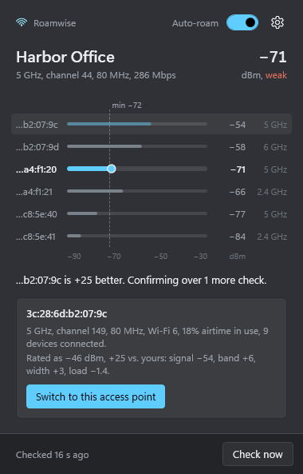
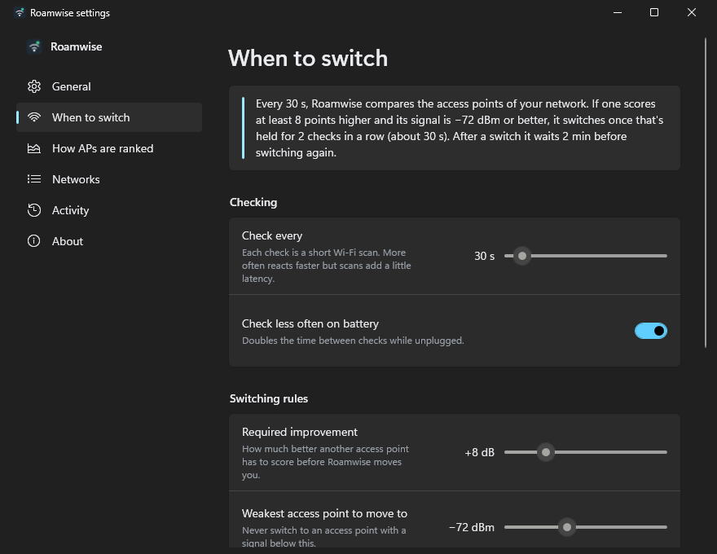

# Roamwise

Roamwise keeps your Windows PC on the best Wi-Fi access point.

Windows tends to stick with the first access point it joined, even after you've walked across the building and three closer ones are in range. On busy networks like offices, campuses, apartment buildings and mesh systems, you end up with a weak, slow connection while a strong one sits next to you. Roamwise runs quietly in the notification area, checks the access points of the network you're on, and moves you to a better one when it's clearly better.

<p align="center">
  
</p>

## What it does

- **Moves you to a better access point.** It ranks every access point broadcasting your network and switches when another one is clearly better. It keeps your current network and uses the saved password Windows already has.
- **Ranks for speed, not just bars.** It starts from signal strength and adds points for 5 GHz and 6 GHz, wider channels and Wi-Fi 6/7. It takes points off busy access points, using the load the AP reports in its beacons or, if it doesn't report one, the number of other radios sharing its channel. The speed bonuses fade out as signal weakens, so a weak 6 GHz link never beats a solid 5 GHz one.
- **Doesn't flap.** A better access point has to stay better for several checks in a row, has to beat yours by a margin you choose, and Roamwise waits between switches. If a switch fails, that access point is skipped for 15 minutes and Windows reconnects you as usual.
- **Shows its reasoning.** The panel draws every access point on one signal scale, with your rules drawn as lines across it, and says in a sentence why it's staying or switching. Select an access point to see its band, channel, width, load and score breakdown, or switch to it yourself.
- **Low-latency mode (optional).** Pauses the background scans Windows runs about once a minute, which cause lag spikes in games and calls. Roamwise turns it back off when it closes.

## Settings

Everything is adjustable from **Settings** (the gear in the panel, or right-click the tray icon).

| Setting | Default | What it means |
| --- | --- | --- |
| Check every | 30 s | How often Roamwise scans. Doubled on battery if you want. |
| Required improvement | +8 dB | How much better another access point must score. |
| Weakest access point to move to | −72 dBm | Never switch to anything weaker than this. |
| Confirm over | 2 checks | The better access point must stay better this many checks in a row. |
| Wait between switches | 2 min | Minimum time between two switches. |
| Only switch when my signal is weak | Off | Leave a good connection alone; look around only below a threshold (default −67 dBm). |
| 5 GHz / 6 GHz bonus | +6 / +8 dB | How much faster bands count for. |
| Avoid 2.4 GHz | Off | Counts 2.4 GHz access points 6 points lower. |
| Account for busy access points | On | Penalize access points with crowded airtime. |
| Which networks | All, except excluded | Or switch to "Only networks I list". Saved networks can be added with one click. |

<p align="center">
  
</p>

## Install

1. Download `Roamwise-win-x64.zip` (or `win-arm64`) from [Releases](https://github.com/TzTech26/roamwise/releases) and unzip it anywhere.
2. Run `Roamwise.exe`. It doesn't need an installer, admin rights, or a separate .NET install.
3. Turn on **Start with Windows** in Settings if you want it to run at sign-in.

**Location access:** Windows treats nearby access points as location data, so it only shares them with apps when **Settings › Privacy & security › Location › Let desktop apps access your location** is on. Roamwise tells you if it's off and links straight to the setting. It never looks up or stores your location.

## How switching works

Roamwise calls the Windows Native Wifi API (`WlanConnect`) with your existing profile and a desired BSSID list containing only the target access point. Windows does the actual association, including authentication, so nothing about your network's security changes. Expect a brief reconnect during a switch, which is why Roamwise only switches when the gain is worth it.

## Build from source

Requires the [.NET 10 SDK](https://dotnet.microsoft.com/download) on Windows.

```bash
dotnet build
```

```bash
dotnet publish src/Roamwise/Roamwise.csproj -c Release -r win-x64 -o artifacts/win-x64
```

Useful switches for `Roamwise.exe`:

- `--background` starts in the tray without opening the panel (used by Start with Windows).
- `--settings [general|roaming|networks|activity]` opens Settings on a page.
- `--diagnose report.txt` writes everything Roamwise sees (adapters, connection, every access point with its score) and exits. Attach it to bug reports.
- `--demo` shows the UI with a made-up busy office network.

Settings and the activity history live in `%APPDATA%\Roamwise`.

## Project layout

```
src/Roamwise/
  Native/WlanNative.cs     P/Invoke declarations for wlanapi.dll
  Wifi/                    Managed Wi-Fi client, scan parsing, 802.11 element parsing
  Core/RoamEngine.cs       The check-rank-decide-switch loop
  Core/ApScorer.cs         How access points are scored
  Core/AppSettings.cs      Settings model and persistence
  UI/                      Tray icon, flyout, signal chart, settings window
tools/make-icon.ps1        Regenerates the app icon
```

## License

MIT. See [LICENSE](LICENSE).
